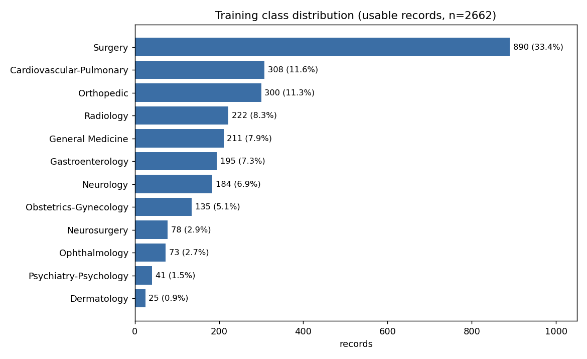

# Data analysis report (auto-generated by analyze_data.py)

All numbers below are computed from the supplied files in this run. Nothing was deleted, repaired in place or balanced.

## 1. Reproduce
```
python analyze_data.py --train /mnt/user-data/uploads/train.csv --test /mnt/user-data/uploads/test_no_labels.csv --output-dir example_outputs/data_analysis
```

## 2. Raw-file / CSV integrity

* train.csv: 2673 physical lines (1 header + 2672 data lines), header present: True.
* Default quote-aware CSV parser returns **2616** data records, all with 5 fields, of which **2613** have a valid label and **3** have a non-specialty 'label' (text fragments).
* Physical lines that begin with `<valid label>;`: **2669**. Every well-formed record was verified to occupy one physical line, so this is the best-supported count of *intended* records; it is an inference from line structure, not something the file states.
* Default parse absorbed **56** intended records into 7 swallowed spans (63 physical lines). Odd-quote physical lines: 14.
* Logical-record status (this analysis): {'clean': 2655, 'quarantined': 7, 'recovered': 3, 'recovered_partial': 4}.
* Root cause supported by evidence: 7 records begin with an unterminated `"` in `description`. Three swallowed spans end in a transcription cut near the 32 767-character spreadsheet-cell limit with the remainder on an orphan line (these produce the fake labels). This mechanism is an inference; the file itself does not say how it was produced.
* test_no_labels.csv: 398 physical lines, default parser 398 records, field counts {4: 398}, **header present: False** (first line is data), odd-quote lines 0, blank lines 0. Verified record count: **398**.

Damaged / non-clean records:

| record_id   | lines     | label                    | status            | method                      |
|:------------|:----------|:-------------------------|:------------------|:----------------------------|
| TR000160    | 161-161   | Cardiovascular-Pulmonary | quarantined       | truncated_open_quote        |
| TR000162    | 163-163   | Psychiatry-Psychology    | recovered         | stray_quote_complete_record |
| TR000713    | 714-714   | General Medicine         | quarantined       | truncated_open_quote        |
| TR000725    | 726-726   | Obstetrics-Gynecology    | recovered         | stray_quote_complete_record |
| TR000946    | 947-947   | Neurosurgery             | quarantined       | truncated_open_quote        |
| TR000960    | 961-962   | General Medicine         | recovered_partial | cell_limit_overflow_join    |
| TR001086    | 1088-1088 | Obstetrics-Gynecology    | quarantined       | truncated_open_quote        |
| TR001094    | 1096-1096 | General Medicine         | recovered_partial | truncated_transcription     |
| TR002087    | 2089-2089 | Surgery                  | quarantined       | truncated_open_quote        |
| TR002098    | 2100-2101 | Neurology                | recovered_partial | cell_limit_overflow_join    |
| TR002326    | 2329-2329 | Surgery                  | quarantined       | truncated_open_quote        |
| TR002334    | 2337-2338 | Surgery                  | recovered_partial | cell_limit_overflow_join    |
| TR002390    | 2394-2394 | Surgery                  | quarantined       | truncated_open_quote        |
| TR002391    | 2395-2395 | Radiology                | recovered         | stray_quote_complete_record |

Full per-item audit: `raw_integrity_audit.csv`; summary: `raw_integrity_summary.json`.

## 3. Label distribution (usable = clean + recovered + recovered_partial)

| label                    |   count |   percent |   quarantined_with_this_label |   clean |
|:-------------------------|--------:|----------:|------------------------------:|--------:|
| Surgery                  |     890 |     33.43 |                             3 |     889 |
| Cardiovascular-Pulmonary |     308 |     11.57 |                             1 |     308 |
| Orthopedic               |     300 |     11.27 |                             0 |     300 |
| Radiology                |     222 |      8.34 |                             0 |     221 |
| General Medicine         |     211 |      7.93 |                             1 |     209 |
| Gastroenterology         |     195 |      7.33 |                             0 |     195 |
| Neurology                |     184 |      6.91 |                             0 |     183 |
| Obstetrics-Gynecology    |     135 |      5.07 |                             1 |     134 |
| Neurosurgery             |      78 |      2.93 |                             1 |      78 |
| Ophthalmology            |      73 |      2.74 |                             0 |      73 |
| Psychiatry-Psychology    |      41 |      1.54 |                             0 |      40 |
| Dermatology              |      25 |      0.94 |                             0 |      25 |



## 4. Missingness
See `missingness.csv` / `missingness.png` (default parse vs repaired vs test).

## 5. Length distributions
See `length_statistics.csv`, `length_extremes.csv` and `*_length_distribution.png`. Token counts are whitespace tokens and a regex approximation; **no downstream tokenizer has been fixed**, so model-token lengths are not reported.

## 6. Duplicates

| level                                                         |   records_considered |   duplicate_groups |   records_in_duplicate_groups |   extra_copies(rows-groups) |   groups_with_label_conflict |   percent_records_in_groups | note                                                  |
|:--------------------------------------------------------------|---------------------:|-------------------:|------------------------------:|----------------------------:|-----------------------------:|----------------------------:|:------------------------------------------------------|
| raw_exact_row(all 5 fields)                                   |                 2662 |                  0 |                             0 |                           0 |                            0 |                        0    | nan                                                   |
| raw_exact_transcription                                       |                 2638 |                731 |                          1530 |                         799 |                          730 |                       58    | nan                                                   |
| normalized_exact_transcription                                |                 2638 |                731 |                          1530 |                         799 |                          730 |                       58    | nan                                                   |
| normalized_exact_combined_input                               |                 2662 |                 82 |                           171 |                          89 |                           82 |                        6.42 | nan                                                   |
| normalized_exact_description                                  |                 2661 |                740 |                          1569 |                         829 |                          734 |                       58.96 | nan                                                   |
| normalized_exact_sample_name                                  |                 2662 |                741 |                          1551 |                         810 |                          741 |                       58.26 | nan                                                   |
| normalized_exact_keywords                                     |                 2219 |                  3 |                             6 |                           3 |                            0 |                        0.27 | nan                                                   |
| near_duplicate(transcription, tfidf word 1-2gram cosine>=0.9) |                 2632 |                735 |                          1544 |                         nan |                          nan |                      nan    | pairs/conflicts in near_duplicate_threshold_sweep.csv |

Near-duplicate threshold sweep (TF-IDF word 1-2gram cosine, field: transcription):

|   cosine_threshold |   pairs |   pairs_with_label_conflict |   records_involved |   connected_groups |
|-------------------:|--------:|----------------------------:|-------------------:|-------------------:|
|               0.8  |     902 |                         884 |               1547 |                733 |
|               0.9  |     887 |                         877 |               1544 |                735 |
|               0.95 |     877 |                         873 |               1540 |                735 |
|               0.99 |     874 |                         873 |               1534 |                732 |
|               1    |     873 |                         872 |               1532 |                731 |

Transcription-level exact-duplicate groups whose members carry different labels: **730** (top label pairs: [(('Orthopedic', 'Surgery'), 152), (('Cardiovascular-Pulmonary', 'Surgery'), 124), (('Gastroenterology', 'Surgery'), 99), (('Obstetrics-Gynecology', 'Surgery'), 67), (('Neurology', 'Radiology'), 58)]; `label_conflict_pairs.csv`, `label_conflict_groups.csv` lists all duplicate levels; nothing resolved automatically). Records whose *entire input incl. keywords* is identical to another record with a different label: **171** in 82 groups (irreducible ambiguity for any input-only model). Train/test overlap: {'test_records': 398, 'test_nonempty_transcription': 396, 'test_with_exact_twin_in_train': 239, 'percent_of_test': 60.05, 'twin_matches_with_multiple_train_labels': 29}. Limitations: cosine on word n-grams ignores word order and can score templated notes with different findings highly; empty texts are excluded from duplicate groups.

### Split leakage simulation (diagnostic, seed 42, val ratio 0.2)

| design                                               |   train_n |   val_n |   val_with_exact_normalized_transcription_in_train |   percent_val_exact_in_train |   val_exact_twin_in_train_SAME_label |   val_exact_twin_in_train_ONLY_DIFFERENT_labels |   percent_val_with_train_cosine>=0.8 |   percent_val_with_train_cosine>=0.9 |   percent_val_with_train_cosine>=0.95 |   percent_val_with_train_cosine>=0.99 |   duplicate_groups_crossing_split |
|:-----------------------------------------------------|----------:|--------:|---------------------------------------------------:|-----------------------------:|-------------------------------------:|------------------------------------------------:|-------------------------------------:|-------------------------------------:|--------------------------------------:|--------------------------------------:|----------------------------------:|
| stratified_random                                    |      2129 |     533 |                                                269 |                        50.47 |                                    1 |                                             268 |                                50.66 |                                50.66 |                                 50.47 |                                 50.28 |                               264 |
| duplicate_aware_grouped(StratifiedGroupKFold fold 0) |      2129 |     533 |                                                  0 |                         0    |                                    0 |                                               0 |                                 0.75 |                                 0    |                                  0    |                                  0    |                                 0 |

Grouping used: exact normalized transcription + near-dup cosine>=0.9; 1851 groups, largest group 4 records. **The model team decides which design is primary**; trade-off: the random split mirrors the (probably duplicate-rich) test distribution but inflates validation scores; the grouped split measures generalisation to unseen notes but gives noisier, harder, less class-balanced validation folds (see `val_class_counts` in the JSON).

## 7. Keyword leakage

| split   |   records |   keywords_nonempty |   specialty_as_first_keyword(prefix pattern) |   percent_prefix |   specialty_string_anywhere_in_keywords |   percent_anywhere |   anywhere_but_not_as_prefix |   prefix_equals_true_label |   prefix_present_but_different_label |   label_name_in_description |   any_specialty_name_in_description |   label_name_in_sample_name |   any_specialty_name_in_sample_name |   label_name_in_transcription |   any_specialty_name_in_transcription |
|:--------|----------:|--------------------:|---------------------------------------------:|-----------------:|----------------------------------------:|-------------------:|-----------------------------:|---------------------------:|-------------------------------------:|----------------------------:|------------------------------------:|----------------------------:|------------------------------------:|------------------------------:|--------------------------------------:|
| train   |      2662 |                2219 |                                         2219 |            83.36 |                                    2219 |              83.36 |                            0 |                       2219 |                                    0 |                          22 |                                  51 |                          18 |                                  28 |                           313 |                                   787 |
| test    |       398 |                 320 |                                          320 |            80.4  |                                     320 |              80.4  |                            0 |                        nan |                                  nan |                         nan |                                 nan |                         nan |                                 nan |                           nan |                                   nan |

Train: prefix equals the true label in 2219 of 2219 prefixed records. Test: 80.4% of test records carry a specialty first-keyword, so the same shortcut exists at test time. Per-class: `keyword_leakage_by_class.csv`.

## 8. Vocabulary
```
{
 "tokenization": "lowercased regex tokens [A-Za-z0-9]+ with internal . - ' / allowed; punctuation dropped for counting; fields: description+sample_name+transcription (keywords excluded)",
 "tokens_total": 1298685,
 "vocab_size": 24461,
 "vocab_size_min_count_2": 18778,
 "negation_term_counts": {
  "no": 7560,
  "not": 2859,
  "without": 1852,
  "denies": 599,
  "denied": 239,
  "negative": 889,
  "none": 967,
  "never": 77,
  "absent": 76,
  "neither": 7,
  "nor": 47,
  "cannot": 104
 },
 "percent_docs_with_negation_term": 88.39,
 "numeric_token_count": 48116,
 "numeric_percent_of_tokens": 3.7,
 "measurement_mentions": 6437,
 "top_measurement_units": [
  [
   "1 cm",
   227
  ],
  [
   "2 cm",
   160
  ],
  [
   "10 mg",
   133
  ],
  [
   "5 mm",
   120
  ],
  [
   "3 cm",
   116
  ],
  [
   "20 mg",
   110
  ],
  [
   "12 mm",
   110
  ],
  [
   "10 ml",
   102
  ]
 ],
 "suspicious_lowercase_start_transcriptions": 2
}
```
Files: `top_tokens.csv`, `top_bigrams.csv`, `top_trigrams.csv`, `class_distinctive_tokens.csv`, `top_abbreviations.csv`, `boilerplate_phrases.csv`. Stop words and negations are NOT removed anywhere.

## 9. Candidate anomalies for the paper (ranked by measured magnitude, verify before citing)

* **CSV structural corruption**: 56 records absorbed + 3 fake labels + 7 quarantined
* **Specialty name in keywords**: 83.36% of train records (80.4% of test)
* **Exact-duplicate transcriptions**: 1530 records in 731 groups (normalized)
* **Validation leakage (random split)**: 50.47% of validation notes have an exact normalized twin in train vs 0.0% in grouped split
* **Class imbalance**: Surgery 33.43% vs Dermatology 0.94%

**Interpretation caution:** when twins carry *different* labels, memorising the training twin is penalised, not rewarded. Compare `val_exact_twin_in_train_SAME_label` vs `..._ONLY_DIFFERENT_labels` before calling duplicates 'leakage'.

## 10. Assumptions, parser choices, limitations
* Record boundary = physical line starting with `<label>;` (verified for all well-formed lines).
* Quarantined / partial records are reported, not hidden; no label was invented or changed.
* Duplicate analysis uses training records only; near-dup vectoriser is fitted on the analysed pool (diagnostic, not a modelling component).
* Snippets are limited to 100 characters.
